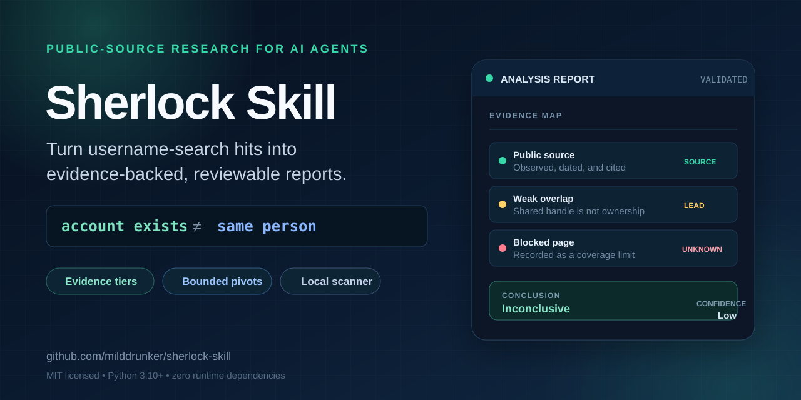

**English** | [简体中文](README.zh-CN.md)

# Sherlock Skill

<p align="center">
  
</p>

**Find as much of a person's publicly discoverable social footprint as
possible, connect accounts with evidence, and turn public activity into an
auditable behavioral profile.**

[](https://github.com/milddrunker/sherlock-skill/actions/workflows/ci.yml)
[](https://www.python.org/)
[](LICENSE)
[](#requirements)

Sherlock Skill is a public-source research workflow for security researchers,
brand-protection teams, and AI agents. Starting from one username, it scans a
bundled 481-site snapshot across social, developer, creator, gaming, marketplace,
and community platforms. It then follows distinctive public clues through
bounded discovery rounds, verifies which accounts have evidence of belonging
together, and synthesizes their public activity into a behavioral profile.

Instead of stopping at **"does this handle appear on a site?"**, the workflow
answers:

> What publicly discoverable social media presence exists for this person,
> which accounts can responsibly be grouped together, and what patterns do
> their public activities reveal?

**Coverage note:** the goal is to find as many publicly discoverable accounts as
possible, not to guarantee exhaustive coverage. Private, login-gated, deleted,
blocked, unindexed, or differently named accounts may remain undiscovered.

## What the behavioral profile covers

- a cross-platform public social account map, including aliases and unassigned
  candidates
- recurring interests, topics, projects, roles, and public communities
- platform-use patterns and public activity cadence
- cross-platform consistency, contradictions, and identity-bearing links
- evidence confidence, source dates, coverage gaps, and login-required unknowns

The profile is limited to purpose-relevant public observations. It is not a
psychological diagnosis, legal identity, or justification for sensitive
inference beyond the authorized scope.

## Overview

Username scanners produce useful discovery signals, but a list of matching URLs
is not an investigation. Pages may be false positives, stale, private, blocked,
or controlled by different people.

Sherlock Skill adds the parts needed for repeatable public-source work:

- clear separation between observed facts and inferences
- evidence tiers and confidence levels
- bounded follow-up searches from distinctive public clues
- behavioral synthesis from public interests, communities, projects, and activity
  patterns
- explicit handling of contradictions, dead ends, and access failures
- privacy minimization and data-disclosure limits
- a consistent Markdown report plus machine-readable evidence
- validation for incomplete reports and unresolved scaffolding

The bundled scanner is implemented in this repository and does not require the
external Sherlock command, `pipx`, an API key, or third-party Python packages.

## Features

- **Agent-ready workflow:** `SKILL.md` defines the review and reporting process
  for any coding agent that can read files and run Python.
- **Bounded discovery:** follows distinctive public leads for at most two
  derived rounds and 12 checks by default.
- **Behavioral profile:** connects public account activity into a structured
  view of interests, communities, projects, and recurring behavior while
  retaining uncertainty and source evidence.
- **Identity safeguards:** a shared username, display name, or search result
  cannot establish same-person linkage by itself.
- **Integrated reporting:** separates evidence-based clusters from unassigned
  candidates and documents failed or blocked checks.
- **Local execution:** the scanner uses only the Python standard library.
- **Auditable outputs:** records source URLs, access dates, confidence, and
  limitations alongside the report.

## Getting started

### Requirements

- Python 3.10 or newer
- Windows, macOS, or Linux
- Network access to the sites being checked

### Create an analysis case

```bash
git clone https://github.com/milddrunker/sherlock-skill.git
cd sherlock-skill

python scripts/username_analysis.py collect \
  --username example_user \
  --workspace .
```

The helper scans the bundled site list and creates:

```text
username_analysis/example_user/
├── username_analysis.md
├── evidence.json
├── sherlock-scan.json
├── sherlock-output.txt
└── sherlock-error.txt
```

Use `--site` to restrict scope and `--timeout` to lower request pressure:

```bash
python scripts/username_analysis.py collect \
  --username example_user \
  --workspace . \
  --site GitHub \
  --site Gitee \
  --timeout 10
```

Run `python scripts/username_analysis.py collect --help` for proxy, worker,
NSFW, and replacement options.

### Run the scanner only

```bash
python scripts/sherlock_scan.py scan \
  --username example_user \
  --output username_analysis/example_user/scan.json
```

### Validate a completed report

```bash
python scripts/username_analysis.py validate \
  username_analysis/example_user/username_analysis.md
```

## Using it with an agent

Provide the skill path, investigation purpose, and scope:

```text
Read /path/to/sherlock-skill/SKILL.md. Research "example_user" for an authorized
brand-impersonation review. Review all public candidates, follow distinctive
public leads within the documented limits, complete the report, and run the
validator.
```

The agent is instructed to keep discovery evidence separate from identity
evidence, avoid private or login-gated information, and leave ambiguous accounts
unassigned.

## Evidence model

| Conclusion | Minimum standard |
|---|---|
| Confirmed | Direct first-party or reciprocal public evidence uniquely connects the profiles |
| Likely | Two independent, non-generic overlaps with no material contradiction |
| Possible | One weak-to-moderate overlap and no contradiction |
| Unrelated | Evidence establishes distinct people or incompatible facts |
| Inconclusive | Evidence is insufficient, inaccessible, stale, or ambiguous |

Public page existence, search ranking, and scanner output are discovery signals,
not proof of ownership. See
[identity-verification.md](references/identity-verification.md) for the full
rubric and [pivot-discovery.md](references/pivot-discovery.md) for the bounded
follow-up procedure.

## Safety and privacy

Use this project only when you have a lawful basis and appropriate scope for
public-source research. Representative uses include authorized security
assessments, personal profile cleanup, brand or impersonation investigations,
lawful due diligence, and research on consenting subjects.

This project is not a people finder and does not establish legal identity. Do
not use it to bypass authentication, collect private data, steal credentials or
sessions, harass or locate people, impersonate someone, or make high-impact
eligibility decisions.

Do not include credentials, private research data, or sensitive personal
information in public issues. Publicly visible information can still be
privacy-sensitive; the workflow favors minimum necessary detail.

## Compatibility and limitations

- Python 3.10+ is required.
- The scanner depends on public endpoints and may encounter CAPTCHAs, WAFs,
  rate limits, or client-side applications that cannot be read without a browser.
- The bundled 481-site snapshot is reproducible but may be older than upstream
  Sherlock. Record that limitation when current coverage matters.
- Scanner results are candidates, not verified account ownership.
- The report validator checks structure, required conclusions, confidence, and
  unresolved scaffolding; it cannot prove that the analysis is correct.

## Development

Run the test suite and validate the bundled site data:

```bash
python -m unittest discover -s tests -v
python scripts/sherlock_scan.py validate-data
```

Focused bug reports and pull requests are welcome. Keep changes within the
documented public-source and privacy boundaries.

## Documentation

- [Agent workflow](SKILL.md)
- [Portable command interface](AGENTS.md)
- [Programmatic manifest](agent-manifest.json)
- [Identity verification](references/identity-verification.md)
- [Bounded pivot discovery](references/pivot-discovery.md)
- [Technical note: discovery is not identity verification](docs/articles/username-search-is-not-identity-verification.md)

## License

This project is independently maintained and is not an official Sherlock
Project release. It is available under the [MIT License](LICENSE). Third-party
data and license notices are listed in [THIRD_PARTY_NOTICES.md](THIRD_PARTY_NOTICES.md).
