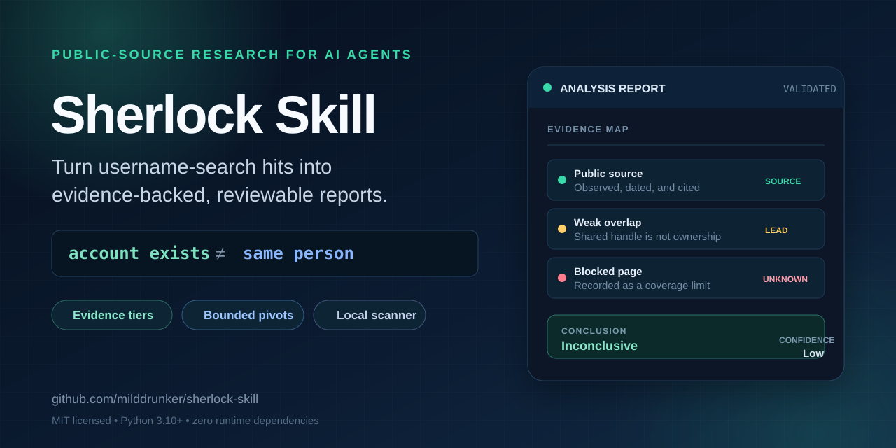

[English](README.md) | **简体中文**

# Sherlock Skill

<p align="center">
  
</p>

**一个用户名，看到更完整的公开社交媒体足迹。**

[](https://github.com/milddrunker/sherlock-skill/actions/workflows/ci.yml)
[](https://www.python.org/)
[](LICENSE)
[](#前置条件)

Sherlock Skill 帮助你看到用户名背后更完整的公开社交媒体画像。从一个用户名
出发，尽可能发现这个人在社交、视频、社区、创作、交易和开发者平台上的公开账号，
再用证据判断哪些资料可能属于同一个人。

最终得到的不是一堆匹配链接，而是一份带来源的公开信息视图：包括兴趣、社区、
活动模式、可能的账号关联，以及目前仍然无法确认的信息。

仅用于合法、经授权的公开信息调查。

## 你会得到什么

- **更完整的公开账号地图：** 一次调查可以覆盖不同类型的平台，而不只局限于
  开发者或游戏社区。
- **更清楚的账号关联：** 明确区分哪些资料有足够证据属于同一人、哪些只是可能，
  以及哪些暂时无法确认。
- **公开行为画像：** 总结反复出现的兴趣、社区、项目、内容风格和活动节奏，
  同时避免把推测写成事实。
- **可复核的证据链：** 每个关键结论都保留来源、访问日期、置信度和覆盖限制。

这不代表能够找到互联网上的全部账号。私密、需要登录、已删除、被拦截、未被索引，
或使用其他用户名的账号，仍可能无法发现。

## 适合谁使用

### 品牌保护与风控团队

发现可能与冒用、仿冒资料或品牌滥用有关的公开账号。对比身份线索，保留矛盾证据，
并输出其他审核人员可以复核的报告。

### 安全研究人员与调查人员

从一个用户名出发扩大公开信息覆盖范围，降低把无关同名账号误认为同一个人的风险。

### 个人隐私自查

查看自己的用户名暴露了哪些公开账号和身份线索，据此发现过度公开、账号分散和需要
优先清理的信息。

如果你要构建 Agent 或内部调查工具，也可以通过可移植 CLI 和机器可读输出接入同一
套流程，见 [Agent 与开发者集成](#agent-与开发者集成)。

## 一次典型调查

1. **输入用户名。** 可以额外提供别名、目标站点或经批准的调查问题。
2. **寻找公开资料。** 运行内置扫描器，并根据有辨识度的公开线索进行有限次数的
   补充检查。
3. **区分“找到”与“确认”。** 逐个查看候选账号，判断是否有证据支持它们属于
   同一个人。
4. **整理公开画像。** 把反复出现的兴趣、社区、角色、项目和活动模式分组，并标注
   置信度。
5. **保留未知项。** 记录被拦截的页面、矛盾、过期信息和必须登录或由账号本人确认
   的内容。

## 配合 Agent 使用

最简单的方式是把仓库路径、用户名和合法用途交给 Agent：

```text
读取 /path/to/sherlock-skill/SKILL.md。对用户名 "example_user" 进行经授权的
品牌冒用调查。查找公开账号，只关联有证据支持属于同一人的资料，总结公开兴趣和
社区，完成报告并运行校验器。
```

Agent 应把公开账号发现和身份确认分开，不访问私密或需要登录的信息，并让证据不足
的账号保持未确认状态。

## 安装并在本地运行

### 前置条件

- Python 3.10 或更高版本
- Windows、macOS 或 Linux
- 可访问待调查站点的网络

不需要外部 `sherlock` 命令、`pipx`、API Key 或第三方 Python 包。

### 创建调查案例

```bash
git clone https://github.com/milddrunker/sherlock-skill.git
cd sherlock-skill

python scripts/username_analysis.py collect \
  --username example_user \
  --workspace .
```

工具会扫描内置的 481 个站点快照，并创建：

```text
username_analysis/example_user/
├── username_analysis.md
├── evidence.json
├── sherlock-scan.json
├── sherlock-output.txt
└── sherlock-error.txt
```

也可以只调查相关平台：

```bash
python scripts/username_analysis.py collect \
  --username example_user \
  --workspace . \
  --site Instagram \
  --site Reddit \
  --site YouTube \
  --timeout 10
```

代理、并发数、NSFW 站点和覆盖已有目录等选项可通过以下命令查看：

```bash
python scripts/username_analysis.py collect --help
```

### 仅运行扫描器

```bash
python scripts/sherlock_scan.py scan \
  --username example_user \
  --output username_analysis/example_user/scan.json
```

### 校验完成后的报告

```bash
python scripts/username_analysis.py validate \
  username_analysis/example_user/username_analysis.md
```

## Agent 与开发者集成

仓库不依赖特定 Agent 或厂商：

- [`SKILL.md`](SKILL.md) 包含完整的调查与报告流程。
- [`AGENTS.md`](AGENTS.md) 提供可移植的命令入口说明。
- [`agent-manifest.json`](agent-manifest.json) 描述入口和输出格式。
- JSON 扫描结果和 Markdown 报告可用于下游 Agent、审核工具或内部看板。

扫描器仅使用 Python 标准库，支持站点过滤、有限并发、HTTP/HTTPS 代理和机器可读
结果。

## 证据判断标准

| 结论 | 最低标准 |
|---|---|
| Confirmed | 直接的第一方证据或双向公开互链，能唯一连接这些资料 |
| Likely | 至少两个独立且有辨识度的重合信号，并且没有重要矛盾 |
| Possible | 一个弱到中等强度的重合信号，并且没有矛盾 |
| Unrelated | 有证据表明属于不同的人，或存在互不兼容的事实 |
| Inconclusive | 证据不足、无法访问、已经过期或存在歧义 |

相同用户名、显示名或搜索排名都只是发现线索，不能证明账号所有权。完整规则见
[identity-verification.md](references/identity-verification.md)，有限线索追踪流程见
[pivot-discovery.md](references/pivot-discovery.md)。

## 安全与隐私

仅在具备合法依据和适当调查范围时使用本项目。典型场景包括经授权的安全评估、
个人资料清理、品牌或冒用调查、合法尽职调查，以及取得当事人同意的研究。

本项目不是人肉搜索工具，也不能确认法律身份。不得用于绕过登录、收集私密数据、
窃取凭据或会话、骚扰或定位他人、冒充身份，或进行就业、信贷、住房等高风险资格
决策。

公开可见的信息仍然可能敏感。报告只保留完成授权问题所需的信息，不要发布凭据、
私密调查数据或不必要的个人资料。

## 兼容性与限制

- 需要 Python 3.10 或更高版本。
- 扫描依赖公开接口，可能遇到验证码、WAF、速率限制，或只能通过浏览器查看的动态页面。
- 内置的 481 个站点快照可以复现调查，但可能旧于上游 Sherlock。
- 扫描结果只是候选账号，不代表已经验证账号所有权。
- 报告校验器只检查结构、必要结论、置信度和未替换内容，不能证明分析本身正确。
- 行为画像描述的是公开活动，不构成心理诊断，也不能替代取得本人同意的核实。

## 开发

运行测试并验证内置站点数据：

```bash
python -m unittest discover -s tests -v
python scripts/sherlock_scan.py validate-data
```

欢迎提交聚焦明确的问题报告和 Pull Request。所有改动都应遵守公开信息和隐私边界。

## 文档

- [Agent 工作流](SKILL.md)
- [通用命令接口](AGENTS.md)
- [程序化清单](agent-manifest.json)
- [身份核验](references/identity-verification.md)
- [有限线索追踪](references/pivot-discovery.md)
- [技术说明：发现账号不等于确认身份](docs/articles/username-search-is-not-identity-verification.md)

## 许可证

本项目独立维护，不是 Sherlock Project 的官方发布。项目采用
[MIT License](LICENSE)。第三方数据和许可证声明见
[THIRD_PARTY_NOTICES.md](THIRD_PARTY_NOTICES.md)。
